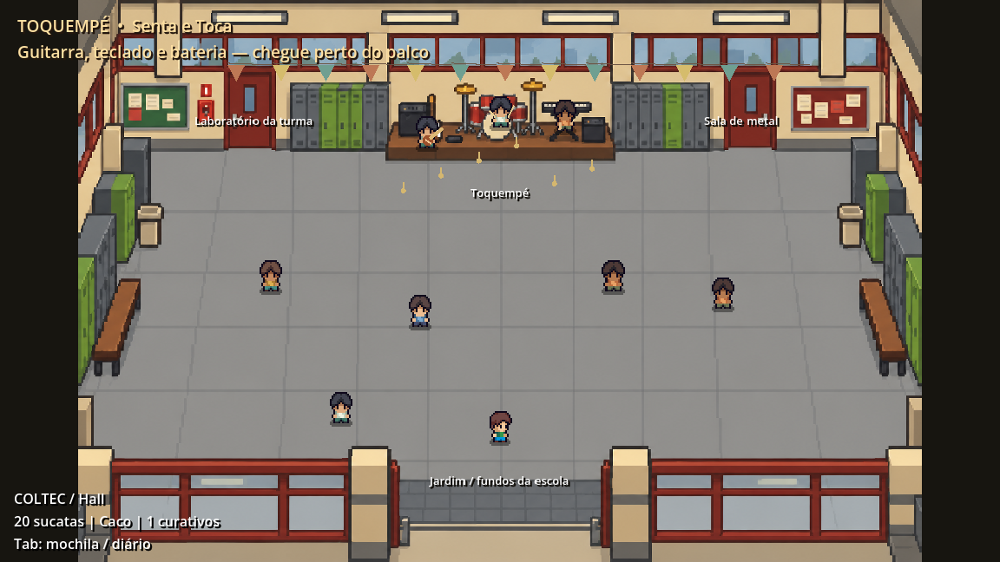
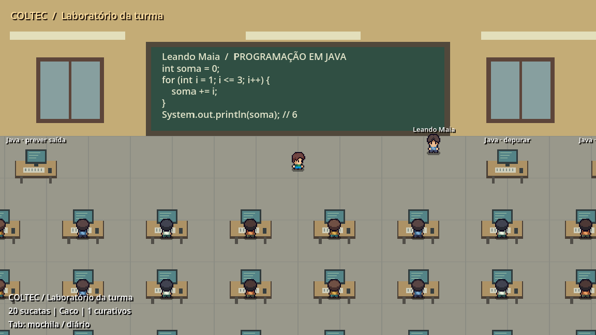

# Disnera — COLTEC

Jogo de ação e exploração top-down desenvolvido no Godot para o trabalho de Tópicos Especiais em POO do COLTEC/UFMG. Explore a escola, converse com a turma e desça aos esgotos para investigar a lenda da Disnera.

## Equipe

Arthur Emanuel, Maria Eduarda, Paulo Henrique, Pedro Silva e Tiago Alves.

## Jogar e editar

1. Instale o **Godot 4.6** (versão usada na validação).
2. Clone este repositório:
   ```sh
   git clone https://github.com/TP-Coltec-UFMG/2026-303-disnera.git
   ```
3. Importe o arquivo `project.godot` no Godot e aguarde a importação dos recursos.
4. Pressione **F6** com `scenes/main.tscn` aberta ou **F5** para iniciar o projeto.

O repositório contém o projeto-fonte completo. Não é necessário copiar a pasta de cache `.godot`. Em computadores com dificuldades com Vulkan, use o renderizador Compatibility:

```sh
godot --path . --rendering-method gl_compatibility
```

## O que há nesta versão

- Hall do COLTEC com Duda, PH, Saci, Tigas, Pedro Silva Freitas e a banda **Toquempé** no evento Senta e Toca.
- Laboratório de informática ampliado, 38 estudantes, computadores e **Leando Maia** ensinando Java. Três atividades: prever saídas, depurar e montar um programa.
- Sala de metal com **Geovane**, circuito de drenagem e acesso ao túnel externo.
- Torneio **Dinsara × Estelionatários**, com atletas animados e disputa jogável de pênaltis.
- Cinco setores de esgoto, armas, loja, curativos, combo, ataque forte, aparo e dash.
- Morcegos com mergulho sinalizado, escorpiões com tiros alternados e Ratão sem dano de contato.
- Refúgio disponível somente após eliminar os inimigos da sala.
- Diário com papel pautado, conversas em balões e interfaces próprias para cada atividade.

Depois do Ratão, o jogador retorna ao COLTEC vazio, no fim do ano, com chuva nas áreas externas e três atividades de lembranças. Os campos destinados à lore futura estão em `data/epilogue_memories.json`.




## Controles

| Ação | Controle |
|---|---|
| Andar | WASD ou setas |
| Interagir / conversar / entrar | E |
| Ataque básico | Clique esquerdo ou direito |
| Ataque forte | F |
| Aparar | R |
| Dash | Espaço, Q ou Shift |
| Mochila e diário | Tab |
| Fechar interação | Escape |

F e R consomem energia, que se recupera com o tempo. O terceiro ataque de um combo causa mais dano. Equipamentos e curativos são gerenciados pela mochila.

## Progresso e limites

O progresso do jogo é mantido durante a sessão; **não há salvamento da campanha em disco**. Iniciar um novo jogo reinicia a campanha. As configurações do menu podem ter persistência própria. Os exercícios de Java são puzzles de lógica, não um compilador nem um executor de código.

Os personagens e diálogos são representações ficcionais. Esta versão mantém espaço para complementar a história futuramente.

## Estrutura

- `Scripts/`, `scenes/`: lógica e cenas do jogo.
- `Imagens/`, `Musica/`, `Fonts/`, `Temas/`, `Shaders/`: recursos visuais, áudio e interface.
- `Cute_Fantasy_Free/`, `RF_Catacombs_v1.0/`: pacotes de recursos usados pelo projeto.
- `data/`: turma e textos das lembranças.
- `tests/`: testes de integração e geração de capturas.
- [Detalhes da expansão](EXPANSAO_COLTEC.md).
- [Histórico das alterações](HISTORICO_ALTERACOES.md).
- [Documentação técnica do módulo de menu](DOCUMENTACAO_MENU.md).

## Validação

Importe antes de executar os testes em uma cópia nova:

```sh
godot --headless --path . --editor --import --quit
godot --headless --path . res://tests/adventure_test.tscn
godot --headless --path . res://tests/epilogue_test.tscn
godot --headless --path . res://tests/turma_combat_test.tscn
godot --headless --path . res://tests/java_ui_test.tscn
```

Os testes verificam progressão, refúgio, combate, NPCs, torneio, exercícios, interfaces e epílogo. Há avisos conhecidos de instâncias/recursos pendentes ao encerrar alguns testes; isso não equivale a uma asserção aprovada. Confira as mensagens `PASS` e eventuais `SCRIPT ERROR`.

## Recursos e autoria

A arte do protagonista foi mantida; NPCs reutilizam suas animações com paletas próprias. Parte dos cenários foi produzida com ferramentas de geração de imagens e posteriormente integrada ao jogo; prompts e histórico estão em `Imagens/Coltec/`. Laboratório, mesas, efeitos e interfaces também usam desenho em código. Preserve os avisos e licenças dos pacotes de terceiros ao redistribuir.
