# 2026-303-Disnera
Trabalho de Tópicos Especiais em POO do Colégio Técnico para a criação de um jogo, apelidado de Disnera. 🐀

## Membros do grupo
- Arthur Emanuel 
- Maria Eduarda
- Paulo Henrique
- Pedro Silva
- Tiago Alves

## Sobre o jogo
Nosso jogo é desenvolvido no Godot. Assim, nossa ideia é de o jogo se passe nos esgotos do COLTEC, no ano de 2024, onde 4 amigos adentraram no esgoto em busca de uma lenda chamada Disnera, um rato albino gigante que mata pessoas - pelo menos é isso o que as lendas dizem. Porém, os garotos nunca mais foram vistos. A polícia foi chamada, mas a UFMG e o COLTEC, com medo de terem sua imagem manchada, abafaram o caso, fazendo com que ele virasse apenas mais uma lenda falada dentro dos corredores do colégio. Entretando, em 2026, a mesma história se reascende com novos amigos que desejavam passar por uma aventura e descobrir a verdade por trás de toda a lenda.

## Especificações Gerais 
- *Gênero:* Ação/Dungeon.
- *Interface:* Top-Down (Perspectiva do jogador) - 
 Corações para representar a vida do jogagor, botão de menu para pausar, sair ou mudar as configurações do jogo, mapa mostrando as salas exploradas (GUI).
- *Progressão da história:* Narrativa e relacional.
- *Personagens e NPCs:* Jogador, Reppo (NPC de ajuda), Disnera (Boss), Baratas (inimigo), Ratos (inimigo), Escorpiões (inimigo), Morcego (inimigo).
- *Cenários:* hall do COLTEC, laboratório de informática, sala de metal, jardim com entrada do túnel, quadra e cinco setores de esgoto.
- *Público Alvo:* Jovens.
- *Plataforma:* PC.

## Telas
- *Tela inicial:* Escolher se deseja começar a jogar, alterar alguma configuração ou sair do jogo.
- *Tela começar jogo:* Iniciar uma nova partida. Nesta versão, o progresso da campanha dura durante a sessão, sem salvamento em disco.
- *Tela de configurações:* Escolher para qual tela de configuração quer ir ou se quer voltar à tela anterior.
- *Tela de acessibilidades:* Alterar as acessibilidades do jogo.
- *Tela de controles:* Alterar os controles do jogo.
- *Tela de audio*: Aumentar ou diminuir os sons do jogo.

<h3 align="center">Tela inicial</h3>
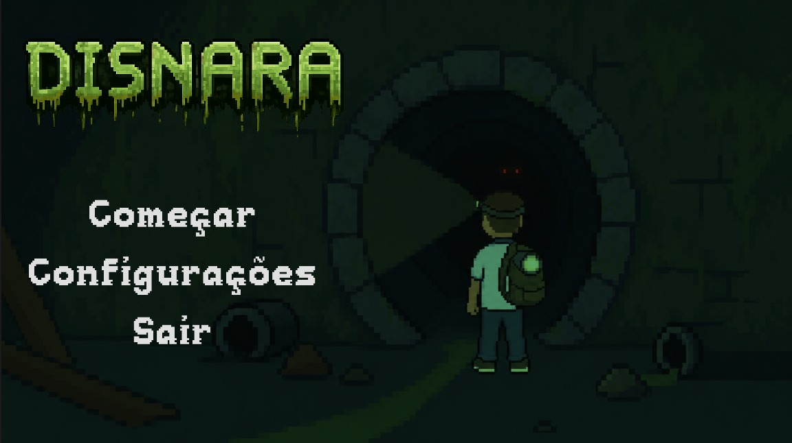 
 
- *Começar:* Iniciar o jogo. 
- *Configurações:* Ir para tela de configurações para o jogador alterar o que desejar.
- *Sair:* Fechar o jogo.

<h3 align="center">Tela começar jogo</h3>
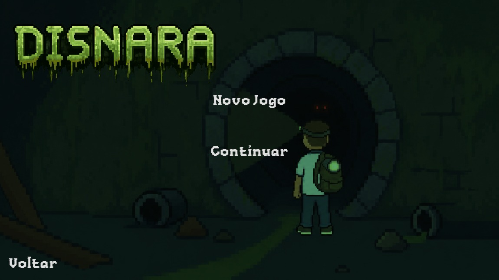

- *Novo jogo:* Iniciar o jogo do zero.
- *Continuar:* Opção prevista no projeto original; a campanha atual ainda não oferece carregamento de um save em disco.
- *Voltar:* Voltar à tela anterior.

<h3 align="center">Tela de configurações</h3>
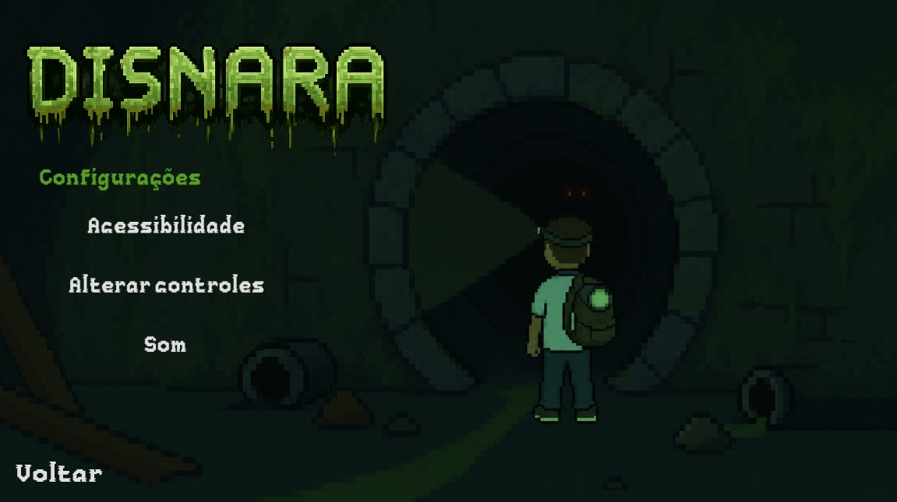

- *Acessibilidade:* Ir à tela de acessibilidades.
- *Controles:* Ir à tela dos controles do jogo.
- *Som:* Ir à tela de sons do jogo.
- *Voltar:* Voltar à tela anterior.

<h3 align="center">Tela de acessibilidades</h3>
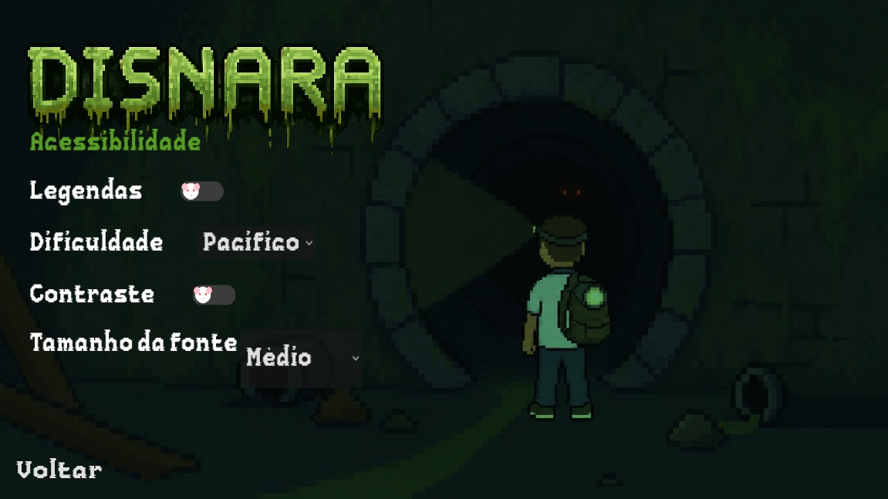 

- *Legenda:* Ativar ou desativar legendas nos diálogos do protagonista ou dos NPCs, ideal para pessoas que sofrem de deficiência auditiva.
- *Dificuldade:* O jogador tem a opção de escolher a dificuldade que quer jogar.
- *Contraste:* Alterar cores do jogo, ideal para pessoas que possuem deficiência ocular.
- *Tamanho da fonte:* Alterar o tamanho da fonte das palavras, altera as palavras das telas e dos diálogos durante o jogo.
- *Voltar:* Voltar à tela anterior.

## Acessibilidade 
Foram implementados quatro recursos de acessibilidade no sistema: modo de alto contraste, aumento do tamanho das fontes, remapeamento dos controles e controle do áudio. A seguir, são apresentadas imagens demonstrando cada recurso e seus respectivos comparativos antes e depois da implementação

<h2>Modo de alto contraste (Menu)</h2>

Modo de alto contraste proporcionando maior diferenciação visual entre os elementos da interface.

<h2>Aumento do tamanho das fontes</h2>

Comparativo antes e depois da aplicação do aumento do tamanho das fontes, facilitando a leitura e a visualização das informações apresentadas na interface.

<h3>Fonte pequena</h3>

<h3>Fonte grande</h3>

<h2>Remapeamento de controles</h2>

O remapeamento dos controles permite que o usuário personalize os comandos do jogo de acordo com suas preferências, tornando a experiência mais acessível e adaptável.

<h2>Configurações de Som</h2>

Os recursos sonoros auxiliam na identificação de eventos e interações, oferecendo ao jogador um feedback adicional além dos elementos visuais.

## Gameplay

O jogo é um *Dungeon Crawler* em visão *top-down*. O jogador deverá atravessar diversos níveis da "masmorra" (o Esgoto), em busca de entender o mistério da Disnera:

O jogo é composto por uma mecânica de combate contra diversos inimigos, além da mecânica de dash, que auxilia na movimentação e na esquiva durante as batalhas. Também conta com puzzles que desafiam o jogador e complementam a experiência de gameplay.

<h3 align="center">COLTEC — antes da descida</h3>

A jornada agora começa na escola. O jogador pode conversar, estudar, acompanhar a banda e participar do torneio antes de investigar o túnel.

- **Hall:** Duda, PH, Saci, Tigas e Pedro Silva Freitas caminham pelo espaço. A banda **Toquempé** participa do evento **Senta e Toca**, com música e um minigame de memória musical.
- **Laboratório de informática:** sala ampliada, computadores individuais e 38 estudantes mais espaçados. **Leando Maia** ensina Java no quadro; os terminais oferecem exercícios de prever a saída, corrigir erros e montar um programa.
- **Sala de metal:** tornos, bancadas e o professor **Geovane**, de cabelo branco. Há uma atividade sobre a ordem do trabalho e o circuito de drenagem que libera o túnel.
- **Exterior:** jardim, plantas e entrada do esgoto em formato de túnel.
- **Quadra:** torneio **Dinsara × Estelionatários**, com atletas animados e disputa jogável de pênaltis, incluindo escolha do canto, força do chute e defesa.

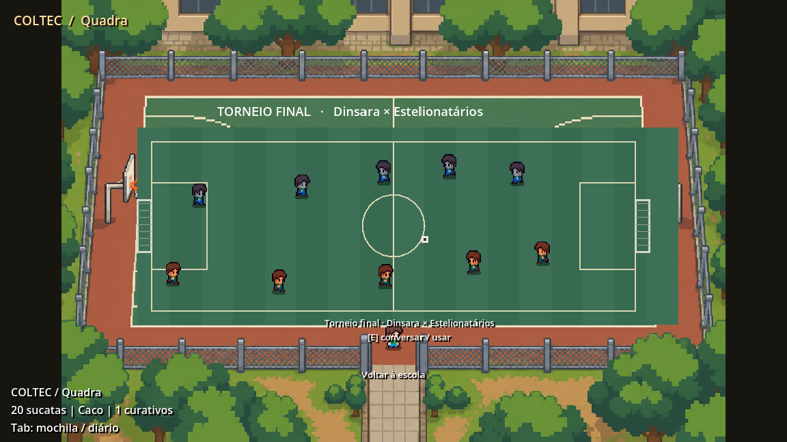

<h3 align="center">Início</h3>

Depois de explorar o COLTEC e abrir a drenagem para entrar no túnel, o jogador chega ao esgoto, onde precisa enfrentar e eliminar todos os inimigos presentes no nível para poder progredir. Enquanto houver inimigos vivos, o acesso ao próximo nível permanece bloqueado. Na primeira fase, o objetivo é derrotar todos os ratos ,que atacam o jogador melle, para liberar a passagem para a próxima área.

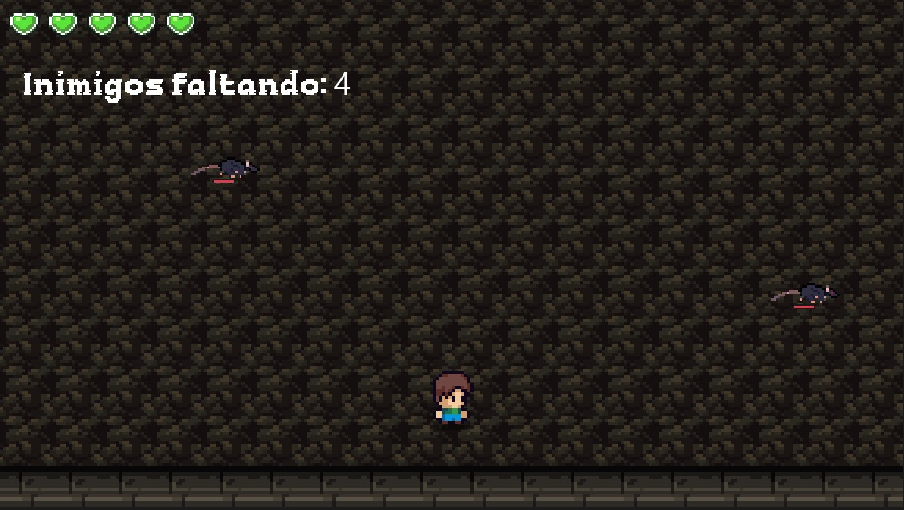

<h3 align="center">Segunda fase - Morcegos e MineGame</h3>

A segunda fase segue a mesma mecânica de progressão, na qual o jogador precisa eliminar todos os inimigos para avançar. Nesta fase, é adicionado o morcego, que possui um comportamento mais agressivo, realizando um dash em direção ao jogador e atacando-o, causando perda de vida.

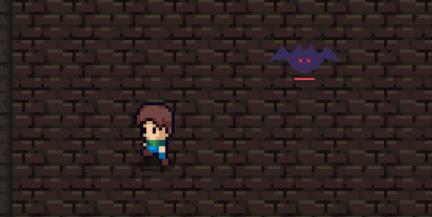

Além disso, a segunda fase conta com um puzzle de alavancas, no qual o jogador deve encontrar a sequência correta de ativação das alavancas para liberar a passagem e progredir para o próximo níve

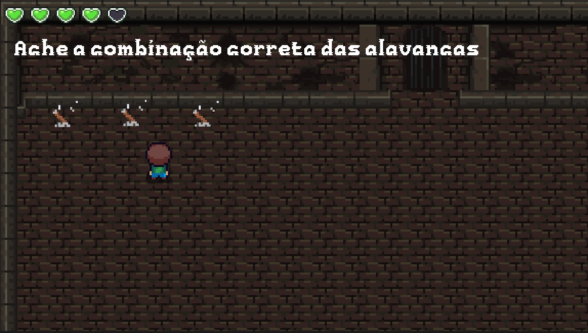

<h3 align="center">Terceira fase - Escorpião</h3>

A terceira fase mantém os mesmos inimigos e a mesma mecânica de progressão, na qual o jogador precisa eliminar todos os inimigos para avançar. Como novidade, é introduzido o escorpião, um inimigo que se afasta do jogador enquanto realiza ataques à distância, lançando projéteis de veneno que causam dano ao jogador.

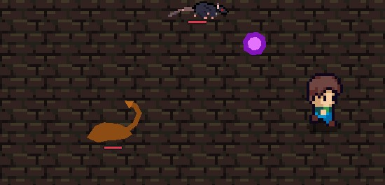

<h3 align="center">Luta contra o Boss</h3>

A batalha final ocorre contra o boss Disnera, que possui diferentes tipos de ataque. Nesta versão, ele não causa dano de contato. Pode lançar uma rajada de veneno que causa dano em área e arremessar grandes pedaços de fezes que caem do céu, causando dano ao jogador. Após derrotar o boss, o jogador retorna automaticamente ao COLTEC vazio, no fim do ano, depois da formatura. Chove nas áreas externas, a banda e os colegas já foram embora, e restam três atividades de lembranças.

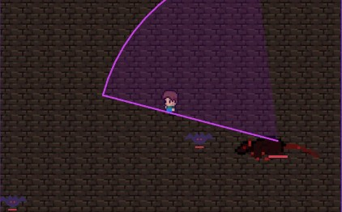

Ataque de veneno em área

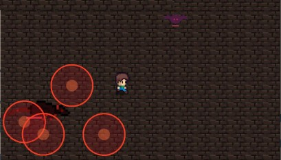

Ataque de vezes do céu

## Mecânicas e funcionalidades novas

- **Combate:** combo de três ataques, ataque forte, aparo e dash. Ataque forte e aparo consomem energia, recuperada com o tempo.
- **Armas e itens:** caco, cano, estilingue, curativos e tampa de proteção, com compras usando sucatas.
- **Inimigos:** o morcego sinaliza a direção antes do mergulho; o escorpião alterna tiro simples e rajada em leque. Seus ataques preparados podem ser interrompidos.
- **Refúgio:** só fica disponível depois de derrotar todos os inimigos da sala. O puzzle das alavancas continua sendo uma condição separada para avançar.
- **Interações:** diário com papel pautado, conversas em balões e interfaces próprias para programação, música, metal, circuito, futebol e lembranças.
- **Minigames:** memória musical, drenagem, três exercícios de Java, atividade da sala de metal e disputa de pênaltis. Recompensas são concedidas uma única vez por atividade.
- **Epílogo:** após o Ratão, explore a escola vazia e chuvosa, organize papéis da despedida, relembre uma melodia e encontre pares no arquivo da Disnara. Os campos para complementar a lore estão em `data/epilogue_memories.json`.

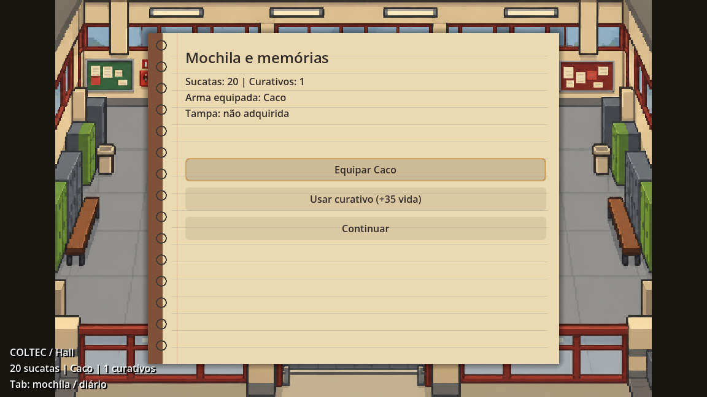

### Controles da versão atual

| Ação | Controle |
|---|---|
| Andar | WASD ou setas |
| Conversar, usar e entrar | E |
| Ataque básico | Clique esquerdo ou direito |
| Ataque forte | F |
| Aparar | R |
| Dash | Espaço, Q ou Shift |
| Mochila e diário | Tab |
| Fechar interação | Escape |

## Mecânica extra
O jogador pode conseguir corações ao matar os inimigos e assim recuperar sua vida. Isso tem o objetivo de deixar o jogo mais fácil e acessível a todos
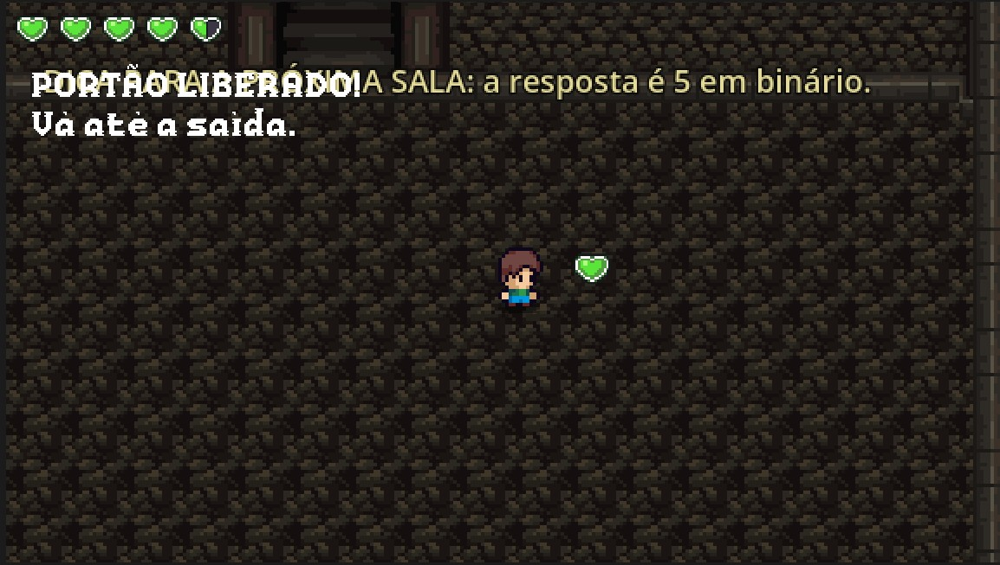

## Como executar

Importe `project.godot` no **Godot 4.6**, aguarde a importação dos recursos e pressione **F5**. A cena inicial é `scenes/main.tscn`. Em computadores com dificuldade com Vulkan, selecione o renderizador **Compatibility**.

A campanha ainda não possui salvamento em disco. O repositório contém o projeto-fonte completo; não é necessário baixar um cache `.godot`.

Os quatro testes de integração da versão atual passaram: aventura, epílogo, turma/combate e Java/interfaces. Persistem avisos de recursos pendentes ao encerrar alguns testes. Instruções e detalhes estão em [EXPANSAO_COLTEC.md](EXPANSAO_COLTEC.md).

As imagens das telas antigas foram preservadas como registro do desenvolvimento; as capturas do COLTEC mostram a versão atual. Preserve os avisos e as licenças dos recursos de terceiros. O histórico de criação e integração dos cenários está em `Imagens/Coltec/`.

## Conclusão

O projeto do jogo Disnera é uma iniciativa pequena, mas ambiciosa, para criar uma experiência imersiva e narrativa dentro de um ambiente inspirado no próprio COLTEC, misturando elementos de ação, exploração e suspense. Além de desenvolver um jogo com mecânicas e interfaces funcionais, o grupo pretende construir uma atmosfera envolvente, utilizando a lenda criada dentro do jogo, em torno da criatura Disnera, como o elemento principal da narrativa. Dessa forma, o trabalho também contribui para o aprendizado prático de conceitos de programação orientada a objetos, desenvolvimento de interfaces e organização de projetos em equipe, unindo criatividade e desenvolvimento técnico em um único projeto que promete ser divertido, intuitivo e desafiador.
